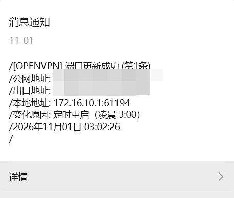

# natmap 端口映射与自动维护系统（OpenVPN 专用版）

> 专为小米/红米路由器（Padavan/老毛子固件）设计的 NAT 穿透与自动维护方案，将路由器上 OpenVPN 服务端的 TCP 61194 端口映射到公网，支持进程保活、防火墙自动修复、微信推送和日志轮转。


---

## 项目简介

- 本版本只保留 **OpenVPN 一个服务**，不包含 ROUTER 5001、NAS 等其他服务。
- 历经多次版本迭代，最终于 **2026-10-30** 完成上线，稳定运行，无异常问题。
- 由于 RM2100 的 Padavan 系统分配的永久性存储空间较小，脚本内置日志轮转机制：**每 7 天或超过 1MB 自动清理日志**。
- 本项目仅涉及 **natmap** 功能。微信测试号推送与域名映射需参考其他教程。
- 脚本内容由 DeepSeek 辅助生成，**下载使用前请将内网 IP、端口替换为自己的实际配置**。
- 适用于当前环境无**公网 IPv4**、需要访问**私网 IPv4 上的 OpenVPN 服务端**的情况。
- 微信测试号推送中会显示三个地址：外网访问使用「**公网地址:端口**」，路由器侧防火墙规则需添加「**出口地址:端口**」。
- natmap 二进制源文件来源 [**heiher/natmap**](https://github.com/heiher/natmap)，其他 shell 脚本文件由 [**DeepSeek 网页版**](https://chat.deepseek.com/) 辅助生成。

### 效果展示

*微信推送效果*<br/>
[](https://github.com/Dave-library/RM2100_Padavan_Natmap_OpenVPN)<br/><br/>
*OpenVPN 客户端连接效果*<br/>
[](https://github.com/Dave-library/RM2100_Padavan_Natmap_OpenVPN)<br/>

### 部分参数参考-具体配置可以参考其他人的
*OpenVPN页面参数设置*<br/>
[](https://github.com/Dave-library/RM2100_Padavan_Natmap_OpenVPN)<br/><br/>
*OpenVPN证书参数*<br/>
[](https://github.com/Dave-library/RM2100_Padavan_Natmap_OpenVPN)<br/><br/>
*client.ovpn参数*<br/>
[](https://github.com/Dave-library/RM2100_Padavan_Natmap_OpenVPN)<br/><br/>

---

## 目录

- [系统概述](#系统概述)
- [快速部署](#快速部署)
- [目录结构](#目录结构)
- [脚本说明](#脚本说明)
- [微信推送](#微信推送)
- [Web 配置](#web-配置)
- [手动命令](#手动命令)
- [日志与轮转](#日志与轮转)
- [STUN 服务器](#stun-服务器)
- [故障排查](#故障排查)
- [扩展与自定义](#扩展与自定义)
- [注意事项](#注意事项)
- [版本信息](#版本信息)

---

## 系统概述

通过 `natmap` 实现 NAT 穿透（打洞），将路由器上 OpenVPN 服务端的 `172.16.10.1:61194/tcp` 端口映射到公网，并自动维护整个流程的稳定性。

### 核心功能

1. 实时监控 WAN IP 变化，每 30 秒检测，变化时自动重启 natmap
2. 进程保活：natmap 和监控脚本崩溃后自动恢复（6 小时冷却防频繁重试）
3. 防火墙自动管理：端口变化时增删 INPUT 规则，规则被误删后 15 秒内补回
4. 微信推送：更新成功/失败、IP 变化原因、服务不可达等实时通知
5. 日志轮转：每天 4:00~6:00 清理超 7 天或超 1MB 的日志文件

### 服务地址与端口

| 项目 | 值 | 说明 |
|------|-----|------|
| OpenVPN 服务端 | `172.16.10.1:61194` | 路由器自身，TCP over IPv4 |
| natmap 映射目标 | `172.16.10.1:61194` | 与 OpenVPN 监听端口一致 |
| VPN 隧道网络 | `172.16.11.0/24` | 客户端隧道 IP 段 |
| VPN 服务端 IP | `172.16.11.1` | OpenVPN 在隧道内的地址 |

### 日志与推送约定

| 项目 | 约定 |
|------|------|
| 系统日志服务名 | `router的openvpn` |
| 微信推送标题 | `[OPENVPN]` |
| 微信推送内容 | 公网地址、出口地址、本地地址、变化原因 |

---

## 快速部署

### 1. 上传脚本并赋权

```bash
chmod +x /etc/storage/bin/natmap/check_ip_change.sh
chmod +x /etc/storage/bin/natmap/openvpn/*.sh
chmod +x /etc/storage/bin/natmap/natmap
```

### 2. 配置微信推送

编辑 `/etc/storage/script/Sh45_wx_send.sh`，提前配置好测试号或 Webhook。

### 3. 添加开机启动

路由器 Web 后台 → **高级设置 → 参数设置 → 脚本** → **在路由器启动后执行**，添加：

```bash
/etc/storage/bin/natmap/check_ip_change.sh &
```

### 4. 添加关机清理

**在路由器关闭之前执行**，添加：

```bash
/etc/storage/bin/natmap/openvpn/stop_openvpn.sh
```

### 5. 保存配置

Web 后台 → **系统管理 → 恢复/导出/上传设置**：

- 「保存 NVRAM 到闪存」→ 提交
- 「保存 /etc/storage/ 内容到闪存」→ 提交

或 SSH 执行：

```bash
mtd_storage.sh save
nvram commit
```

### 6. 手动启动测试（可选）

```bash
/etc/storage/bin/natmap/check_ip_change.sh &
tail -f /etc/storage/bin/natmap/openvpn/logs/openvpn_ip_monitor.log
```

---

## 目录结构

```text
/etc/storage/bin/natmap/               主目录
├── check_ip_change.sh                 主监控脚本（常驻后台）
├── natmap                             natmap 二进制程序
└── openvpn/                           OpenVPN 服务目录
    ├── monitor_openvpn.sh             端口监控（解析日志、管理防火墙、推送）
    ├── start_openvpn.sh               启动脚本
    ├── stop_openvpn.sh                停止脚本
    └── logs/
        ├── openvpn_ip_monitor.log     主控日志
        ├── openvpn_natmap.log         natmap 输出日志
        └── openvpn_debug.log          monitor 调试日志
```

---

## 脚本说明

### check_ip_change.sh（主监控脚本）

- 每 30 秒获取一次稳定的 WAN IP
- IP 变化时重启 OpenVPN 的 natmap
- 保活检测：若 natmap 或 monitor_openvpn.sh 进程缺失，自动拉起
- 每日 4:00~6:00 执行日志轮转
- 内网 IP 不可达时发送微信告警，进入 6 小时冷却
- 将 IP 变化原因写入 `/tmp/ip_change_reason_openvpn`

日志文本：

```text
[ensure_openvpn] router的openvpn 被调用
[ensure_openvpn] router的openvpn 进程存在
[ensure_openvpn] router的openvpn 冷却中，跳过检测
router的openvpn IP 可达，启动 router的openvpn natmap 和 monitor
router的openvpn IP 不可达，下次检测: ...
IP变化，重启 router的openvpn natmap (172.16.10.1:61194)
停止旧 router的openvpn natmap 进程 PID=...
已启动新 router的openvpn natmap (172.16.10.1:61194)
```

启动方式：

```bash
nohup /etc/storage/bin/natmap/check_ip_change.sh > /dev/null 2>&1 &
```

### monitor_openvpn.sh（端口监控）

- 监控 `openvpn_natmap.log`，提取最新公网 IP 和端口
- 检测到端口变化时，等待 20 秒确认稳定
- 更新防火墙规则（删除旧端口，添加新端口）
- 将当前端口写入 `/tmp/natmap_openvpn_port`
- 发送微信推送，标题固定为 `[OPENVPN]`
- 每 15 秒巡检防火墙规则，缺失时自动补充

日志文本：

```text
检测到 router的openvpn 公网地址和端口变化: ...
检测到 router的openvpn 出口地址和端口变化: ...
router的openvpn 端口不稳定或 IP 变化，放弃本次更新
防火墙 INPUT 规则已添加: router的openvpn 出口地址端口: -> ...
防火墙 INPUT 规则缺失，已自动补充: router的openvpn 出口地址端口: -> ...
已发送微信推送: router的openvpn 公网地址和端口: -> ...
已发送微信推送: router的openvpn 出口地址和端口: -> ...
```

锁文件：`/tmp/monitor_openvpn.lock`

### start_openvpn.sh（启动脚本）

- ping 目标内网 IP `172.16.10.1`，不可达则退出并微信告警
- 启动 natmap（若未运行）
- 启动 monitor_openvpn.sh（若未运行）

日志文本：

```text
[start_openvpn] 目标 IP 172.16.10.1 不可达，跳过启动 router的openvpn natmap
[start_openvpn] 启动 natmap (router的openvpn)
[start_openvpn] 启动 monitor_openvpn.sh
```

> **注意**：日常保活由 `check_ip_change.sh` 负责，本脚本仅用于首次启动或手动调试。开机时不要执行，否则拨号未完成会误报警告。

### stop_openvpn.sh（停止脚本）

- 从 `/tmp/natmap_openvpn_port` 读取当前端口并删除规则
- 从 `openvpn_natmap.log` 提取所有历史端口并删除
- 停止 natmap 和 monitor_openvpn.sh 进程
- 删除锁文件

日志文本：

```text
[stop_openvpn] 已删除 router的openvpn INPUT 规则（端口 ...）
[stop_openvpn] 已停止 router的openvpn natmap (PID: ...)
[stop_openvpn] 已停止 monitor_openvpn.sh (PID: ...)
[stop_openvpn] router的openvpn 的 natmap 相关进程处理完成，添加的防火墙规则已删除
```

### natmap（核心二进制）

```bash
natmap -d -s turn.cloudflare.com -h baidu.com -b 0 -t 172.16.10.1 -p 61194
```

| 参数 | 说明 |
|------|------|
| `-d` | 守护进程模式 |
| `-s` | STUN 服务器 |
| `-h` | 心跳检测域名 |
| `-b 0` | 绑定所有接口 |
| `-t 172.16.10.1` | 目标内网 IP（路由器自身） |
| `-p 61194` | 目标端口（OpenVPN TCP 监听端口） |

输出格式示例：

```text
2026-10-30 22:41:02 112.114.45.178 35286 2001::89d6:7072:2db2 42566 tcp 100.64.233.20
```

列含义：日期 时间 公网IP 公网端口 内网IP 本地端口 协议 目标IP

**客户端连接方式**：

使用微信推送中的「公网地址: 公网IP:公网端口」，不是固定的 61194。

```text
公网地址: 112.114.45.178:35286
```

---

## 微信推送

### IP 变化触发

| 场景 | 推送原因 |
|------|----------|
| 凌晨 3:00 定时重启 | 定时重启（凌晨 3:00） |
| 手动重启（SSH/Web） | 手动重启（SSH/Web 触发） |
| PPPoE 断线重连 | 网络断线重连（PPPoE 链路中断） |
| 凌晨 2:00~5:00 重拨 | 运营商例行维护（凌晨时段重拨） |
| 其他 | 外网链路变化，重新拨号 |

### 端口变化触发

若 120 秒内有 IP 变化原因，则复用该原因；否则使用「端口映射重新分配」。

### 推送标题与内容

| 类型 | 标题 |
|------|------|
| 成功 | `[OPENVPN] 端口更新成功 (第N条)` |
| 失败 | `[OPENVPN] 端口更新失败 (第N条)` |
| 不可达 | `[OPENVPN]内网服务不可达` |

成功内容示例：

```text
公网地址: 112.114.45.178:35286
出口地址: 100.64.233.20:42566
本地地址: 172.16.10.1:61194
变化原因: 外网链路变化，重新拨号
```

### 防重复

同一端口 60 秒内不重复推送。

---

## Web 配置

在 **在路由器启动后执行** 中只添加一条：

```bash
/etc/storage/bin/natmap/check_ip_change.sh &
```

**不要**添加 `start_openvpn.sh`，原因：

- 开机时 PPPoE 拨号尚未完成，start 脚本会误判内网不可达并发送错误告警
- 主脚本启动后 30 秒内拨号完成，自动拉起服务，流程正常

在 **在路由器关闭之前执行** 中添加：

```bash
/etc/storage/bin/natmap/openvpn/stop_openvpn.sh
```

保存配置：

```bash
mtd_storage.sh save
nvram commit
```

---

## 手动命令

| 操作 | 命令 |
|------|------|
| 启动服务 | `/etc/storage/bin/natmap/check_ip_change.sh &` |
| 停止所有服务 | `stop_openvpn.sh` + kill 主进程 |
| 重启主监控 | `pkill -f check_ip_change.sh`，等待 2 秒后重新启动 |
| 查看进程 | `ps \| grep -E "natmap\|monitor_openvpn\|check_ip" \| grep -v grep` |
| 查看防火墙 | `iptables -L INPUT -n \| grep ACCEPT` |
| 查看放行端口 | `cat /tmp/natmap_openvpn_port` |
| 测试自动修复 | `iptables -D INPUT -p tcp --dport <端口> -j ACCEPT`，等 15~30 秒 |
| 查看主控日志 | `tail -f /etc/storage/bin/natmap/openvpn/logs/openvpn_ip_monitor.log` |
| 查看 natmap 日志 | `tail -f /etc/storage/bin/natmap/openvpn/logs/openvpn_natmap.log` |
| 查看调试日志 | `tail -f /etc/storage/bin/natmap/openvpn/logs/openvpn_debug.log` |
| 查看系统日志 | `logread \| grep monitor_openvpn \| tail -20` |

---

## 日志与轮转

| 日志文件 | 记录者 | 内容 |
|----------|--------|------|
| `openvpn_ip_monitor.log` | `check_ip_change.sh` | IP 变化、保活事件、日志轮转 |
| `openvpn_natmap.log` | `natmap` | 公网 IP + 端口 |
| `openvpn_debug.log` | `monitor_openvpn.sh` | 防火墙更新、推送结果 |

轮转策略：

- 触发时间：每日凌晨 4:00~6:00（2 小时窗口，避免错过）
- 触发条件：文件修改时间超过 7 天 **或** 文件大小超过 1MB
- 处理方式：清空文件内容（不删除文件）
- 标志文件：`/tmp/natmap_log_rotate_done_YYYYMMDD`（同一天只执行一次）
- 轮转对象：`openvpn_ip_monitor.log`、`openvpn_natmap.log`
- 轮转记录：写入 `openvpn_ip_monitor.log`，并记录到系统日志

> `openvpn_debug.log` 不参与自动轮转，因为它只保存微信返回的 JSON，通常很小；如需清理，手动执行 `> openvpn_debug.log` 即可。

---

## STUN 服务器

| 类型 | 地址 |
|------|------|
| 国内推荐 | `stun.qq.com`、`stun.l.google.com:19302` |
| 国际通用 | `turn.cloudflare.com` |
| 自建 | 部署 coturn，指定 `-s your-vps-ip` |

修改位置：

- `check_ip_change.sh` 中 `ensure_openvpn()` 和 `restart_natmap()` 里的 natmap 启动命令
- `start_openvpn.sh` 中的 natmap 启动命令

三处都要改，保持一致。

---

## 故障排查

### 微信没有推送

```bash
ls -la /etc/storage/script/Sh45_wx_send.sh
tail -50 /etc/storage/bin/natmap/openvpn/logs/openvpn_debug.log
logread | grep monitor_openvpn | tail -20
```

### 服务无法启动

```bash
tail -50 /etc/storage/bin/natmap/openvpn/logs/openvpn_ip_monitor.log
ps | grep -E "natmap|monitor_openvpn|check_ip" | grep -v grep
ping -c 3 172.16.10.1
netstat -lntp | grep 61194
```

### 防火墙规则未自动补充

```bash
ls -la /tmp/natmap_openvpn_port
ps | grep monitor_openvpn
logread | grep "防火墙 INPUT 规则缺失" | tail -5
```

### 客户端无法连接 OpenVPN

```bash
# 确认微信推送里的公网地址是最新的
# 确认路由器本机 61194 可访问
netstat -lntp | grep 61194

# 确认 iptables 有 natmap 本地端口的 ACCEPT 规则
iptables -L INPUT -n | grep ACCEPT

# 确认 natmap 日志有公网 IP 和公网端口输出
tail -20 /etc/storage/bin/natmap/openvpn/logs/openvpn_natmap.log
```

常见错误：

| 客户端报错 | 原因 |
|---|---|
| `Connection refused` | 公网端口不对，或防火墙未放行 |
| `TLS handshake failed` | 证书或加密参数不一致 |
| `AUTH_FAILED` | 账号密码错误（如启用了账号认证） |
| `crypto_alg: CHACHA20-POLY1305: not found` | 客户端不支持该算法，改 `data-ciphers` 列表 |

### 日志没有轮转

```bash
ps | grep check_ip
date +%H
ls -la /tmp/natmap_log_rotate_done_*
```

---

## 扩展与自定义

### 更换推送方式

修改所有脚本中调用 `/etc/storage/script/Sh45_wx_send.sh` 的部分，替换为飞书、钉钉、邮件等，保持参数格式一致。

### 调整检测间隔

- `check_ip_change.sh` 主循环 `sleep 30`
- `monitor_openvpn.sh` 主循环 `sleep 15`

### 修改端口

如果 OpenVPN 服务端端口不是 `61194`，需要同时修改：

- `check_ip_change.sh` 中 `ensure_openvpn()` 和 `restart_natmap()` 的 `-p` 参数
- `start_openvpn.sh` 中的 `-p` 参数
- `pgrep` 匹配模式 `"natmap.*172.16.10.1.*61194"`
- `monitor_openvpn.sh` 中本地地址文本 `"172.16.10.1:61194"`
- `stop_openvpn.sh` 中 `pgrep` 匹配模式

### 修改目标 IP

OpenVPN 服务端在路由器自身，目标 IP 固定为 `172.16.10.1`。如果 OpenVPN 服务端在 NAS，需要把 `172.16.10.1` 全部替换为 NAS 的 IP，并确认该 IP 固定可达。

---

## 注意事项

1. 所有脚本必须具有可执行权限（`chmod +x`）
2. 修改脚本后必须执行 `mtd_storage.sh save` 或 Web 页面「保存 /etc/storage/ 内容到闪存」
3. 防火墙规则保存在内存，重启后丢失，由 monitor 脚本重新添加
4. 日志轮转策略可防止存储撑爆，轮转窗口为 4:00~6:00
5. 端口记录文件在 `/tmp`，重启后丢失，但 natmap 日志有完整历史
6. 确保内网 IP `172.16.10.1` 固定且可达（OpenVPN 在路由器自身时天然满足）
7. 微信推送脚本需提前配置好 Webhook 或 API
8. 开机启动只加 `check_ip_change.sh` 一条命令，不要加 `start_openvpn.sh`
9. 若需要更改 STUN 服务器，请同时修改 `check_ip_change.sh` 和 `start_openvpn.sh` 中的 `-s` 参数
10. OpenVPN 服务端 Web 端配置为 TCP over IPv4、端口 61194，iptables 规则也使用 `tcp`，不要改成 `udp`
11. 客户端连接使用微信推送的「公网地址: 公网IP:公网端口」，不是固定的 61194

---

## 版本信息

| 项目 | 内容 |
|------|------|
| 脚本名称 | natmap 端口映射与自动维护系统（OpenVPN 专用版） |
| 版本 | v1.0 |
| 上线日期 | 2026-10-30 |
| 最后更新 | 2026-10-30 |
| 适用平台 | Padavan / 老毛子固件（小米/红米路由器） |
| 服务地址 | `172.16.10.1:61194`（TCP over IPv4） |
| 隧道网络 | `172.16.11.0/24` |
| 日志服务名 | `router的openvpn` |
| 微信标题 | `[OPENVPN]` |
| 依赖工具 | natmap, iptables, pgrep, flock, logger, date, awk, grep, sed, cut, tr, xargs, ping, kill, ps, sleep, tee, nohup |

---

## License

MIT
